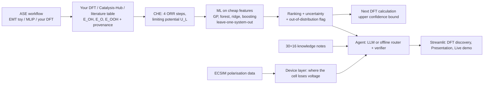

# PEMFC Cathode Catalyst Intelligence: DFT-guided screening, explained and diagnosed

**Project 3 | AI Product: From Model to Product** · escalation of *Project 2 (PEM fuel-cell voltage prediction)*

> *From atomic-scale DFT descriptors to AI-guided catalyst selection and experimental decision-making for PEMFC cathodes.*
> A researcher gets a ranked list of cathode catalyst candidates (ORR limiting potential from DFT, or an ML prediction **with uncertainty** for candidates without DFT), stability flags, sourced explanations, the **next DFT calculation to run**, and, at device level, where a real Pt/C cell loses voltage.

| | |
|---|---|
| **User** | PEMFC / electrocatalysis researcher deciding which candidates get DFT, synthesis and testing |
| **Input** | composition, facet, optional DFT adsorption energies; polarisation curves; lab comments; questions |
| **Output** | limiting-potential ranking with uncertainty and out-of-distribution flag, stability flags, cited explanations, next DFT calculation; device-level failure zone |
| **Decision** | which candidates go to DFT, which to synthesis, which to drop |
| **Costliest mistake** | recommending a catalyst from values that are not DFT (predicted, toy, synthetic) or from chemistry the model has not seen. Every value carries a **provenance**; with non-DFT training data the product gives **no recommendation** |
| **Tracks** | **model track** (DFT-descriptor ML screening with uncertainty; voltage and comment models) + **LLM track** (RAG over DFT/stability notes, agent with DFT tools, report) |

## The DFT core in one picture



## What DFT is and is not doing here
* **Is:** the computational hydrogen electrode turns OH, O and OOH adsorption energies (referenced to H2O and H2) into four free-energy steps and a theoretical limiting potential (`src/dft.py`, unit-tested: the steps add up to −4.92 eV and every step is downhill at U_L).
* **Is not:** a DFT engine. No DFT code ran while this was built, **no real DFT value is bundled**, and the ASE workflow (`src/dft_jobs.py`) and the live Catalysis-Hub query (`src/dft_data.py`) are **untested against real systems**: only the energy bookkeeping and the parser (on hand-written fixture strings) are tested.
* **Data honesty:** without `data/dft/dft_table.csv` (schema in `data/dft/README.md`) the app and notebooks use a **synthetic demo table** whose only purpose is to exercise the pipeline. Every result computed on it tests the *method*, is labelled with a red banner, and **must not be quoted**. With a real table the same code produces real results.

## Quick start (fresh clone, keys stay out of Git)

```bash
git clone <your repo> && cd pemfc-cathode-ai
python -m venv .venv && source .venv/bin/activate
pip install -r requirements.txt
streamlit run app/streamlit_app.py
```

* **No data step needed.** On first run the app shows a *first-run screen* that downloads the ECSIM dataset (CC BY 4.0) or copies it from a folder you already have; the same thing is `python download_data.py [--from-dir PATH]`. The models are then built automatically (seconds to about a minute) into `models/`.
* **No key needed.** Without one, everything runs offline. To go live, either type `OPEN_AI_KEY` and `OPEN_AI_MODEL` in the sidebar (kept in the browser session only), or `cp .env.example .env` and fill it in.
* **Git hygiene is enforced, not just advised:** `.env`, `.streamlit/secrets.toml`, `data/raw/`, `models/` and `data/reviews/user_reviews.jsonl` are git-ignored; the sidebar's *Keys and Git check* shows each rule; `tests/test_bootstrap_app.py` fails if one goes missing and `test_no_api_key_in_repository_files` scans the repo for key-like strings. I checked a simulated clone: 84 tracked files, none of the above.
* **Present from the app.** The **Presentation** tab is the 10-slide deck (timer, speaker notes) and the **Live demo** tab runs the five demo steps on preloaded examples, with a preflight panel and a warm-up button.

Rebuild the notebooks with outputs: `./run_all.sh` (data → 3 notebooks → tests).

### Live vs offline (notebooks and app)

* **Notebooks 01-03** each have a *connection panel*: `USE_LIVE`, `ASK_FOR_KEY` (hidden prompt) and `MODEL_NAME`. It sends one tiny test call and prints `MODE: LIVE` or `MODE: OFFLINE`; notebook 01 then runs the LLM-alone baseline, and notebook 02 shows **offline and live answers side by side** (RAG and agent).
* **Streamlit sidebar**: `OPEN_AI_KEY`, `OPEN_AI_MODEL` (GPT-6-LUNA), a *Test live connection* button and a mode switch (Auto / Offline only / Side by side). The RAG and Chatbot tabs show both answers in two columns in side-by-side mode.

### OpenAI key and model

```
# .env  (git-ignored)
OPEN_AI_KEY=sk-...
OPEN_AI_MODEL=GPT-6-LUNA
```

* `src/config.py` reads `OPEN_AI_KEY` (or `OPENAI_API_KEY`) and `OPEN_AI_MODEL`; the app also accepts them in the
  sidebar (session only) or `.streamlit/secrets.toml`. **No key is in the code or in git.**
* The model name is sent to the API **exactly as written**. I could not call the API while building this, so
  `GPT-6-LUNA` is untested here: confirm the id exists for your account. If the call is rejected the client records
  the error and the product continues in **offline mode** (extractive RAG answers, keyword-routed agent).
* Dollar costs are shown only if you set `OPEN_AI_PRICE_IN_PER_1M` / `OPEN_AI_PRICE_OUT_PER_1M`; tokens and seconds are always shown.

### Live vs offline (notebooks and app)

* **Notebooks 01-03** each have a *connection panel*: `USE_LIVE`, `ASK_FOR_KEY` (hidden prompt) and `MODEL_NAME`. It sends one tiny test call and prints `MODE: LIVE` or `MODE: OFFLINE`; notebook 01 then runs the LLM-alone baseline, and notebook 02 shows **offline and live answers side by side** (RAG and agent).
* **Streamlit sidebar**: `OPEN_AI_KEY`, `OPEN_AI_MODEL` (GPT-6-LUNA), a *Test live connection* button and a mode switch (Auto / Offline only / Side by side). The RAG and Chatbot tabs show both answers in two columns in side-by-side mode.

### OpenAI key and model

```
# .env  (git-ignored)
OPEN_AI_KEY=sk-...
OPEN_AI_MODEL=GPT-6-LUNA
```

* `src/config.py` reads `OPEN_AI_KEY` (or `OPENAI_API_KEY`) and `OPEN_AI_MODEL`; the app also accepts them in the
  sidebar (session only) or `.streamlit/secrets.toml`. **No key is in the code or in git.**
* The model name is sent to the API **exactly as written**. I could not call the API while building this, so
  `GPT-6-LUNA` is untested here: confirm the id exists for your account. If the call is rejected the client records
  the error and the product continues in **offline mode** (extractive RAG answers, keyword-routed agent).
* Dollar costs are shown only if you set `OPEN_AI_PRICE_IN_PER_1M` / `OPEN_AI_PRICE_OUT_PER_1M`; tokens and seconds are always shown.

## Pinecone (optional) and deploying the app publicly

* **Optional vector store.** In the sidebar choose *Retrieval backend: Pinecone*, paste `PINECONE_API_KEY` (or set it in `.env` / `st.secrets`), click *Index the notes in Pinecone* (creates the index with an integrated embedding model if missing, uploads the notes with `doc_id`, `topic` and `evidence` metadata) and every RAG answer then retrieves from Pinecone, with a **fallback to local retrieval** if anything fails. Local retrieval stays the default.
* **Comments are per session.** They live only in the visitor's browser session and vanish when it closes (set `PERSIST_COMMENTS=1` for a single-user machine). With *Remember my comments in Pinecone* on, they are also stored in a namespace only that session knows, and **Delete my comments** removes them everywhere.
* **Status of this code:** `src/vectorstore.py` follows Pinecone's documented integrated-embedding API (SDK v5-v7: `create_index_for_model`, `upsert_records`, `search`, `delete`). It has **not been run against Pinecone**: it is tested with a fake client. Check your SDK version and the Pinecone docs on first use.
* **Before putting it on the public internet:** (1) each visitor types their own `OPEN_AI_KEY` (safe), or you set a key and a spending cap; (2) the Pinecone index holds only the public knowledge notes plus opt-in, session-scoped comments; (3) do not store personal data in comments; (4) keep `.env` and `secrets.toml` out of Git; (5) the Streamlit first-run download needs outbound internet.

## Notebooks (the course template: 3 notebooks, run in order)

| # | Notebook | Content |
|---|---|---|
| 01 | `01_framing_and_baseline` | framing (user, decision, costliest mistake), data quality, **DFT table and provenance**, splits, 38-question evaluation set, baselines (mean voltage, BM25, LLM alone, **single-quantity and oracle DFT rankings**) |
| 02 | `02_build` | **DFT track**: CHE limiting potential, ASE workflow, ML screening with uncertainty (4 models × 2 targets, leave-one-system-out), candidates, stability flags, next calculation. **Device layer**: physics zones, voltage models, comment classifiers. **LLM track**: retrieval, grounded answers (offline vs live), 10-tool agent, report, design choices |
| 03 | `03_evaluate` | the report: DFT ranking vs baselines, uncertainty calibration, out-of-distribution test, worst errors, voltage test files scored once, injected faults, 38 questions, cost, saved pipeline, R&D agent, conclusions |

## Results (offline run; the DFT rows are on the SYNTHETIC demo table: method check, not chemistry)

| Area | Result | Reads as |
|---|---|---|
| DFT screening, leave-one-system-out (**demo data**) | GP MAE 0.071 V, Spearman 0.74, 90%-interval coverage 0.93; ΔG_OH→volcano route ranks better (ρ 0.83, top-10% recall 0.36) but its intervals are over-confident (coverage 0.69) | method runs end to end; a trade-off between ranking and calibrated uncertainty |
| DFT baselines (**demo data**) | strain heuristic ρ −0.66 (wrong sign on this table), electronegativity ρ 0.60, d-band ρ 0.26, oracle volcano ρ 0.84 | a single cheap quantity can rank backwards: check its direction on real data |
| Out-of-distribution (**demo data**) | feature distance alone flagged **0%** of held-out systems; the element-list rule flags all (by construction) | the rule, not the distance, protects the user |
| Voltage, held-out **files**, scored once | RF MAE **0.080 V** (R² 0.77) vs mean baseline 0.194 V | device layer, unseen files only |
| Failure-zone screening (injected faults) | zone right for **95 %** of detected faults; **46 %** of faults detected | a flag is credible; silence is not proof |
| Retrieval, 32 answerable questions | hit@4: BM25 0.97, hybrid 0.97, dense (LSA) 0.94 | keyword baseline is hard to beat |
| Answers, offline extractive, 38 questions | 38/38 answered, gold note cited 84%, **3 of 6** out-of-scope refused (the 3 look-alikes were answered), 0 invalid citations | look-alike questions need the live model and `NOT_IN_KB`; verify with your key |
| Comment NLP (synthetic, phrase-grouped) | sentiment F1 0.92, aspect 0.50 (chance 0.17) | aspect tags are suggestions |
| Cost | offline: 0 tokens; RF model 42 MB | fill live tokens/$ by running notebook 03 with a key |

## Honest limitations (read before presenting)

1. **No real DFT data is bundled and no DFT calculation was run.** DFT-layer results here are on a synthetic demo table; the ASE workflow and the live Catalysis-Hub query are untested against real systems. The ECSIM device data are Pt/C in oxygen only, so they say nothing about alloys or air.
2. **The evaluation questions were written by the same author after the notes**, so retrieval numbers are optimistic. Add independent questions.
3. **The comments corpus is synthetic**; the lexicon was written by the same author. Real labelled comments are needed.
4. **Failure thresholds are screening heuristics** (peer-relative, z ≥ 1.5), not validated failure criteria; there are no fault labels in the data.
5. The LLM paths (`GPT-6-LUNA`, tool calling, JSON extraction, report summary) were tested with a **scripted stand-in**, not the live API. The notebooks were executed offline; rerun notebooks 02 and 03 with your key to record online behaviour and cost.
6. One lab, one MEA design, no repeats across labs, no frequency axis in EIS (HFR/arc are proxies).
7. This is a research screening aid, not a safety or design authority (note K27).
8. The DFT knowledge notes (K31-K46) are original, hedged summaries written by the author; constants such as the 3.2 eV OOH-OH offset and the 0.35/0.05/0.40 eV corrections are commonly reported values to **verify against your own setup**. The elemental table (electronegativity, lattice constants, standard potentials) holds textbook reference values; bulk potentials are a leaching heuristic, not DFT.

## Repository layout

```
app/streamlit_app.py       10-tab app (first-run screen, Presentation, Live demo, ...); app/deck.py = the slides as data
src/                       config, data, physics, models, rag, reviews, agent, rd_monitor, evaluation, functions, llm
notebooks/                 01_framing_and_baseline, 02_build, 03_evaluate (with outputs)
data/knowledge/            30 original notes (K01-K30);  data/README.md explains data, licence, traps
eval/eval_questions.json   26 questions (22 answerable with gold notes, 4 out-of-scope)
reports/                   metrics CSVs, figures, example report
tests/                     19 tests (no key needed; the Streamlit AppTest skips itself if streamlit is missing)
RUBRIC.md                  the course rubric (kept from the template)
download_data.py  requirements.txt  run_all.sh  .env.example
```

Git hygiene: `data/raw/`, `models/`, `mlruns/`, `.env`, `.streamlit/secrets.toml`, `data/reviews/user_reviews.jsonl` are git-ignored; run `git status` before every commit. If a key is ever committed, revoke it.

## Tests and the fresh-clone check

`pytest -q` checks leakage guards, file-grouped splits, loss-budget arithmetic, injected-fault descriptors, surrogate
refusal, retrieval quality, abstention, citation/DOI verification, the agent loop with a scripted LLM, the
`OPEN_AI_KEY`/`OPEN_AI_MODEL` settings, comment NLP, the R&D DOI guard and a scan for key-like strings.

## Data and citation
Hamidi S., Haghighi S., Askari K. (2020), ChemRxiv, doi:10.26434/chemrxiv.11902023 (CC BY 4.0) · https://github.com/ECSIM/pem-dataset1
